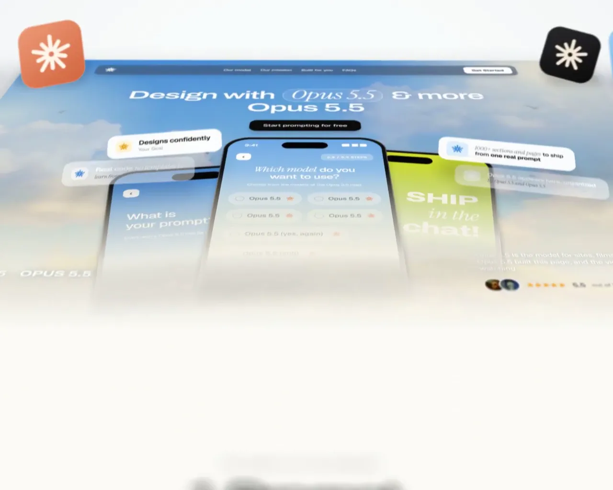

# Agasty Enterprises &bull; Advanced AI Systems & Kinetic Software

Official web platform for **Agasty Enterprises** ([agasty.cloud](https://agasty.cloud)), architects of intelligent mobile applications, precision sensor platforms, and autonomous AI systems.



---

## 🚀 Key Highlights & Features

- **Modern Glassmorphic Dark Architecture**: Built with Tailwind CSS, custom glass panels, neon gradient accents, and obsidian dark aesthetics.
- **Interactive Motion Visuals**:
  - Embedded 60fps high-definition motion videos showcasing 3D spatial viewports, UI state morphing, abstract cybernetic flows, and kinetic typography.
  - Video progress tracking, sound toggle, clip switching tabs, and fullscreen modal player.
- **Live Deflection Physics Simulator**:
  - Real-time interactive Euler-Bernoulli cantilever beam deflection simulator on HTML5 canvas.
  - Live calculation of maximum deflection ($y_{\text{max}}$ in mm), natural modal frequency ($f_n$ in Hz), simulated gyroscope rate ($\pm^\circ/\text{s}$), and bending stress ($\sigma$ in MPa).
  - Demonstrates the core algorithms powering Agasty's flagship **Deflection** mobile sensor application.
- **Flagship Portfolio Showcase**:
  - **Deflection**: High-precision smartphone structural sensor & modal vibration analytics.
  - **RailBlock**: Critical railway operations & block safety coordination.
  - **Scan The Table**: Contactless QR hospitality SaaS & live table analytics.
  - **RosterLab**: Automated workforce scheduling & shift optimizer.
  - **OHE Records**: Railway overhead equipment inspection & tripping logs.
- **Dynamic Scope & Timeline Estimator**:
  - Interactive multi-select widget that estimates architecture delivery timeline and tier based on client requirements.
- **Unified Brand Experience Across All Legal Pages**:
  - Modernized `privacy.html`, `terms.html`, `DeflectionPrivacy.html`, and `RosterLabPrivacy.html` sharing the same aesthetic, typography, and navigation.

---

## 📁 Repository Structure

```
├── assets/
│   ├── css/
│   │   └── style.css            # Custom animations, glassmorphism, glowing borders & marquee
│   ├── js/
│   │   └── main.js              # Background particle canvas, video reel, physics simulator & estimator
│   ├── videos/                  # High-definition UI motion graphics loops
│   │   ├── motion-3d-scroll.mp4
│   │   ├── motion-ui-states.mp4
│   │   ├── motion-abstract-cyber.mp4
│   │   ├── motion-superx.mp4
│   │   └── motion-kinetic-type.mp4
│   └── images/                  # High-res WebP posters and UI visuals
│       ├── poster-3d-scroll.webp
│       ├── motion-ui-states.webp
│       ├── motion-abstract-cyber.webp
│       ├── motion-superx.webp
│       └── motion-kinetic-type.webp
├── index.html                   # Main landing page
├── privacy.html                 # Agasty Cloud applications privacy policy
├── terms.html                   # RailBlock terms and conditions
├── DeflectionPrivacy.html       # OHE Records & Deflection privacy policy
├── RosterLabPrivacy.html        # RosterLab privacy policy
├── app-ads.txt                  # Authorized digital ads verification
└── README.md                    # Project documentation
```

---

## 🛠️ Local Development & Preview

You can open `index.html` directly in any modern browser, or run a local lightweight HTTP server:

```bash
# Using Node.js
npx serve .

# Using Python
python -m http.server 8080
```

Visit `http://localhost:8080` in your web browser.

---

## 📬 Contact & Inquiries

- **Official Website**: [agasty.cloud](https://agasty.cloud)
- **Consultation Form**: [n8n Workflow Form](https://n8n.srv1090344.hstgr.cloud/form/0cb7287e-cd6f-48e4-9029-9852894f781b)
- **Direct Support**: [support@agasty.cloud](mailto:support@agasty.cloud)

&copy; 2026 Agasty Enterprises. Devised for the intelligent era.
